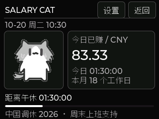

# ESP32 Touch Dashboard & Toolbox

[](https://github.com/mengqy2022/Esp32-touch/actions/workflows/build.yml)
[](https://github.com/mengqy2022/Esp32-touch/actions/workflows/host-tests.yml)
[](LICENSE)

[中文说明](README_CN.md) · [Documentation](docs/README.md) · [Changelog](CHANGELOG.md)

A 320×240 touchscreen dashboard with live PC monitoring, local Codex / Claude Code token
statistics and estimated CNY costs, selected PC window sharing with touch control,
plus games, system utilities, inventory
management and an offline vocabulary lab. A small Windows companion application
installs per user, starts after login and waits for the USB device automatically.

**Hardware target: `esp32`, ESP-IDF 5.5.4, LVGL 8.4.** The repository name is
historical: the validated device reports ESP32-D0WD-V3, not ESP32-S3. Keep the
target, pin map and display orientation for this board. Other boards need porting.

## Features

| Area | Current behavior |
| --- | --- |
| Home | Date, weekday, Wi-Fi status, clock; CPU/GPU/RAM rings, temperatures and RAM usage. Home stays visible when idle. |
| AI usage | Tap CODEX / CLAUDE on the device to switch independent daily usage; selection survives reboot. Daily tokens on the left, estimated CNY cost on the right. EXE selection remains a fallback. No daily goal. Refreshes about every 5 seconds. |
| GAME | Sudoku, 2048, Flappy, Snake and Breakout; pause/resume and restart controls. |
| SYSTEM | PC SCREEN, SD check, system info, Wi-Fi, confirmed touch calibration and PC details. |
| OTHER | Salary Cat, SD-backed inventory/BOM and Vocab Lab with local wordbooks, study plans, spaced review and touchscreen dictation. |
| Windows companion | Dark desktop GUI with Device, PC SCREEN, AI Usage and Settings/Logs pages; searchable window selection, COM checks, CH340 diagnostics/installation, login startup and pause/resume. |

PC telemetry requires the companion to run. Games and local utilities remain
usable independently. GPU data depends on a supported NVIDIA driver; CPU
temperature is best effort. Unavailable sensors display `--`. PC data expires
after 5 seconds, Codex data after 90 seconds.

Codex usage comes from locally retained session logs. It is not a server billing
or subscription quota API. Prices are user-supplied configuration, with an
editable default USD/CNY rate of 7.20. AI usage packets contain only aggregate
counts and cost, without prompts or credentials. Enabling PC SCREEN also transmits
pixels from the selected window, which may contain private information.

## Device screens

| Home: PC monitoring and AI usage | GAME: five offline games |
| --- | --- |
|  |  |
| SYSTEM: device and connection tools | OTHER: salary, inventory and vocabulary |
|  |  |

Tap a category at the bottom of Home to open it; BACK returns from a tool to its
category and from a category to Home. Tap CODEX / CLAUDE on the device to select
independent usage. Salary Cat is under **OTHER → SALARY CAT**.
The [illustrated device guide (Chinese)](docs/HOME_DASHBOARD_CN.md) explains entry
points, game controls and tool requirements, including PC SCREEN.

These are 320×240 screenshots rendered offscreen from the actual current LVGL
page code with fixed sample data, not device photos. See [image provenance](docs/images/device/README.md)
for capture scope. They illustrate the source; published binary versions are listed separately in the download guide.

## Salary Cat

The 2026-10-20 source adds [Salary Cat](docs/SALARY_CAT_CN.md) under **OTHER → SALARY CAT**:
a monochrome dashboard with transparent animated weekday cats, scheduled earnings,
work-time/countdown, on-device salary/shift/workday settings, manual date overrides,
a 2026 China holiday calendar and optional boot page. Tap the amount to cycle daily,
monthly and annual estimates. October 2026 has **18 workdays**, including the Saturday
makeup workday on October 10; October 1–7 are holidays.
It estimates scheduled time, requires a valid clock and does not record attendance.
See the download/validation documents for published binary versions and tested scope.



The image above captures the actual LVGL page rendered offscreen at 320×240 using
sample data (CNY 6,000/month, 09:00–12:00 and 14:00–17:00). It is not a device photo.
[Screenshots and controls](docs/SALARY_CAT_CN.md#关键界面截图) cover earnings, settings,
date overrides and makeup workdays; [image provenance](docs/images/salary-cat/README.md)
explains the capture method.

## Windows quick start

1. [Download ESP32TouchDashboard.exe](https://github.com/mengqy2022/Esp32-touch/raw/refs/heads/main/dist/ESP32TouchDashboard.exe)
   or build it using the instructions below. The published Windows x64 EXE is
   also available in [dist/](dist/README.md), with a SHA-256 checksum.
2. Connect the device. Install its USB serial driver if Windows does not expose a
   COM port; the tested board uses CH340.
3. Double-click the EXE to open the desktop GUI. Select a port on the Device page
   and choose connect/resume. Python is not required.
4. For per-user installation and a Start menu shortcut, run
   `ESP32TouchDashboard.exe --install`. Installation uses the current runtime directory
   and enables login startup. A first run from a non-C drive uses `.dashboard`
   beside the EXE by default; see the user guide for directory selection rules.

See the [Windows user guide](docs/WINDOWS_APP_CN.md) for migration, updates,
removal and troubleshooting. Pause monitoring before flashing or using another
serial tool.

The [PC SCREEN firmware package and flashing instructions](dist/PC_SCREEN_FIRMWARE_CN.md)
provide the full system upgrade for the tested ESP32 board, including PC SCREEN and games.

## PC SCREEN and game upgrade — 2026-10-18

Use companion **2026.10.18.4** with the updated firmware. In the GUI's **PC SCREEN**
page, search by window title/process and double-click a window or select share.
On the device, open **SYSTEM → PC SCREEN**. Select another window in the GUI to
switch without reopening the serial port; stop sharing clears the target.

Tap a point, then cycle **2X → 4X → 8X → FIT** to zoom around the last touched
position. A tap also sends a left click. Drag while zoomed to pan; **UP / DN**
scroll the target, including ChatGPT. Selecting NetEase Cloud Music
(`cloudmusic.exe`) shows **PREV / PLAY / NEXT / VOL- / VOL+** controls.
Version .4 fixes capture stopping at `Switching window...` after the GUI exits;
the background continues running when the GUI closes.

The wire frame is 320×176 RGB332; the ESP32 uses a 256×140 indexed cache to fit
available RAM. Small text in a full window still needs zoom. The 115200-baud
link is for low-rate viewing/control. Minimized/GPU windows and background input
depend on each app; run the target and Dashboard at matching, ordinary privileges.

Snake and Breakout join Sudoku, 2048 and Flappy. Games have **II / GO** pause/resume
and **NEW** restart (new puzzle in Sudoku). 2048 supports swipes, Sudoku has a
larger keypad/highlights, and Flappy has updated visuals/status. See the
[device guide](docs/HOME_DASHBOARD_CN.md) and [validation record](docs/VALIDATION.md)
for controls and tested limits.

## Build from source

Firmware, in an ESP-IDF 5.5.4 environment:

```sh
idf.py set-target esp32
idf.py build
idf.py -p COM5 flash
```

Use the port assigned to your device; COM5 is only an example. For an existing
configured build, keep its configuration rather than resetting the target.

Windows EXE, with Python 3.11 x64 and PowerShell:

```powershell
powershell -NoProfile -ExecutionPolicy Bypass -File .\build_exe.ps1
```

Output: `dist/ESP32TouchDashboard.exe`. The script creates an isolated packaging
environment and pins pyserial/PyInstaller to the validated versions. Full
instructions and manual hardware tests are in the [developer guide](docs/DEVELOPMENT.md).

For a source-only host run (Windows or the existing Linux monitoring path):

```sh
python -m pip install -r tools/requirements.txt
python tools/pc_monitor_host.py --port COM5 --codex-prices tools/codex_prices.json
```

The installer, background supervisor, desktop GUI and window capture are Windows only.

## Repository layout

```text
main/                  ESP-IDF firmware, LVGL UI, drivers and tools
tools/                 Host sender, Codex reader, Windows app and tests
docs/                  Functionality, app guide, architecture, protocol, roadmap
sdcard_template/       Public starter inventory/BOM and vocabulary examples
.github/workflows/     Firmware CI, host tests, manual Windows packaging
build_exe.ps1          Build the standalone Windows EXE
start_dashboard.ps1    Install if needed, select AI source and resume
stop_dashboard.ps1     Pause monitoring and release the serial port
```

Git contains source, generic configuration, documentation and the explicitly
published Windows companion EXE, PC SCREEN full firmware ZIP and checksums. Other generated firmware/EXEs,
build environments, recovery images and local runtime data are excluded.
The manual Windows workflow produces a downloadable Actions artifact;
it does not automatically publish a GitHub Release.

## Documentation and contribution

- [System functionality](docs/HOME_DASHBOARD_CN.md)
- [Windows installation and usage](docs/WINDOWS_APP_CN.md)
- [Codex counting and pricing](docs/CODEX_USAGE_CN.md)
- [Architecture](docs/ARCHITECTURE.md) and [serial protocol](docs/PROTOCOL.md)
- [Hardware](docs/HARDWARE.md) and [vocabulary format](docs/VOCABULARY.md)
- [Development and release guide](docs/DEVELOPMENT.md)
- [Validation record](docs/VALIDATION.md) and [future work](docs/ROADMAP_CN.md)
- [Contribution guidelines](CONTRIBUTING.md)

MIT license: [LICENSE](LICENSE). Component and wordbook notices:
[third-party notices](docs/THIRD_PARTY_NOTICES.md). Personal inventory, Codex logs,
flash backups and account data must remain local.
