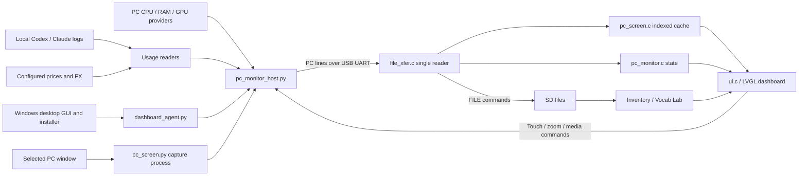

# Architecture

The firmware owns the display, embedded UI and local tools. The host sends numeric
telemetry and, when PC SCREEN is open, pixels from one selected application window.
The same UART owner handles telemetry, frames and device touch/control replies.

## Firmware modules

| Module | Responsibility |
| --- | --- |
| `main/main.c` | Startup, services and application tasks; home remains visible at idle. |
| `main/ui.c`, `ui.h` | Dashboard, category navigation, tool screens and refresh logic. |
| `main/lv_port.c` | LVGL task, display/touch integration and UI command queue. |
| `main/pc_monitor.c`, `pc_monitor.h` | PC telemetry parser, state snapshots, timestamps and independent validity. |
| `main/file_xfer.c` | Sole console UART reader; dispatches PC, SCREEN and FILE transfers. |
| `main/pc_screen.c`, `pc_screen.h` | SCREEN session/validation, 320×176 wire frames, 256×140 indexed cache, input replies. |
| `main/arcade.c`, `arcade.h` | Snake and Breakout game state and rules; UI integrates them with Sudoku, 2048 and Flappy. |
| `main/net_utils.c` | USB/Wi-Fi time sync, timezone and time source tracking. |
| `main/sd_monitor.c` | SD lifecycle and scan/check operations. |
| `main/wifi_mgr.c` | Scan, connect, stored credentials and reconnect. |
| `main/inventory.c`, `main/vocabulary.c` | SD-backed tools and their data engines. |
| LCD/touch drivers and `board_pins.h` | Board-specific hardware implementation. |

LVGL objects must be accessed from its task; other tasks post commands using
`lv_port_post_cmd()`. Keep long filesystem/network operations out of the drawing
loop. Preserve the shared UART reader rather than adding competing readers.

The UART fix processes every complete line in a read chunk and retains a partial
line across reads. FILE:PUT binary data begins only after FILE:READY, so it must not
be concatenated ahead of that handshake. Firmware logs and protocol replies share
the output stream; the host/tool must distinguish them by prefix.

Codex updates are independent of PC samples. Receiving a CODEX line does not extend
the lifetime of STAT values. CPU/GPU/RAM expire in 5 seconds, Codex in 90 seconds;
Codex also requires the matching local date. Counts and cost use signed 64-bit values.
The yen sign uses a tiny dedicated glyph rather than a large additional font.

## Host modules

| Module | Responsibility |
| --- | --- |
| `tools/desktop_dashboard.py` | Per-user install, Run registration, control commands and driver/native dialogs. |
| `tools/dashboard_gui.py` | Persistent desktop control center: device, window search/share, AI and settings/logs pages. |
| `tools/dashboard_agent.py` | Single-instance file lock, device polling/matching, telemetry worker supervision, pause marker, rotating logs. |
| `tools/pc_monitor_host.py` | In-process worker; samples OS providers, synchronizes time, sends PC packets, reads device logs. Also runnable directly in a terminal. |
| `tools/codex_usage.py` | Incremental offsets, counter deltas, daily/model aggregation, pricing and packet formatting. |
| `tools/ai_usage.py` | Claude Code cache-aware usage, duplicate assistant-message snapshots, independent Codex/Claude selection. |
| `tools/device_settings.py` | Validated settings, PnP diagnostics including missing-driver devices, signed vendor installer/UAC. |
| `tools/pc_screen.py` | Window identity, isolated capture with timeout, crop/zoom mapping, RGB332 RLE and targeted input/media messages. |

The background supervisor runs its telemetry worker in a Python thread, avoiding a
second Python telemetry subprocess. Window capture uses its own isolated process.
PyInstaller onefile still has bootloader/worker OS processes. The desktop GUI is
independent of the background; closing it leaves monitoring and capture running.
Background launch sets `PYINSTALLER_RESET_ENVIRONMENT=1` so its extraction files
survive GUI exit, fixing the .4 capture-worker startup failure.

The agent polls ports approximately every 2 seconds. It prefers configured identity
details and waits if several candidates cannot be resolved. Matching CH340 hardware
is not proof of dashboard firmware; capability handshake is future work.

Config is reloaded every polling cycle; changing device/source safely stops and
joins the old worker before starting the new worker. A window-only change resets
capture/viewport state in the running worker without reopening the serial port.
Price JSON is read during each usage recomputation.
There is no persistent database for usage: offsets and counters live in memory,
and a restart reconstructs today's counts from retained logs. Directory enumeration
still occurs on every scan, even though file contents are read incrementally.

## Privacy and boundaries

The firmware receives host name, aggregate loads, temperatures, RAM, time/date,
token count, source name and estimated cost. AI usage packets contain no conversation
content or account credentials. PC SCREEN additionally sends selected-window pixels,
which can include conversation text or other sensitive content visible in that window.
The usage reader accesses log bytes locally but decodes only
model/usage records. Runtime log reports may contain local paths or usage figures
and should be reviewed before sharing.

The host does not query actual billing, fetch exchange rates or update itself.
Automatic startup belongs to the logged-in Windows user. Serial exclusivity is
still required between telemetry, inventory transfers, flashing and monitors.
