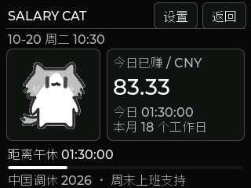
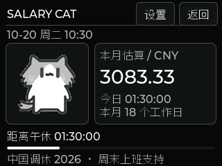
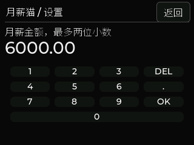
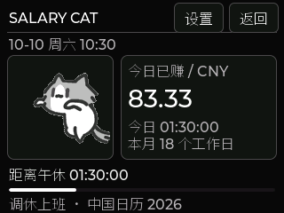

# 月薪猫：工资进度与工作日设置

月薪猫是现有固件的独立页面，入口为 **OTHER → SALARY CAT**。
保留原主页为默认开机页，不会到点打断 PC SCREEN、AI、游戏或其他工具。
本次代码版本为 2026-10-20；完整实机验收情况见 [验证记录](VALIDATION.md)。

## 关键界面截图

以下图片直接使用当前 `main/salary_ui.c`、页面字体和动画数据，经同版 LVGL 8.4
在电脑离屏渲染截取，原始尺寸均为 **320×240**，**不是实物屏幕照片**。
示例时间固定为 2026-10-20 10:30，默认月薪 6,000 元、每天两段共 6 小时、当月 18 个工作日；
调休示例另用 2026-10-10 10:30。设置存储使用内存替身，配图不证明设备触摸和重启保存通过。
[图片来源与图注](images/salary-cat/README.md)记录每张图片的含义。

### 黑白动态主页


左侧猫咪按星期循环播放，透明背景融入黑白面板；右侧显示金额和今日工作时长，
下方为距离下一班次节点的倒计时及进度条。离开月薪猫会释放动画缓存，不打断其他功能。

### 轻触金额：今日、本月、年薪

| 今日已赚 | 本月估算 | 年薪估算 |
| --- | --- | --- |
|  |  |  |

轻触右侧大字金额依次切换。示例中 10:30 已工作 1.5 小时，今日 **83.33 元**；
月内此前 9 个工作日加今日进度，本月 **3,083.33 元**；年薪为 **72,000 元**。
三者均按排班估算，午休不累计，也不代表实际发薪。

### 设备设置与金额输入

| 可滑动的设置列表 | 月薪数字键盘 |
| --- | --- |
|  |  |

右上角进入设置；上下滑动修改月薪、四个上下班时间、每周工作日、中国调休和开机页面。
数字键盘的 `DEL` 删除，`OK` 确认当前字段，回到设置后点 **保存**才提交薪资与排班。
时间按四位数字输入，例如 `0900` 表示 09:00。

### 每周排班、指定日期与周末补班

| 每周工作日 | 指定日期 | 10 月 10 日补班 |
| --- | --- | --- |
|  |  |  |

每周工作日高亮表示上班；指定日期可选 **上班／休息／自动**，该项立即保存，
“自动”删除个人日期覆盖。判断优先级为 **手动日期 → 中国调休表 → 每周排班**。
10 月 10 日虽是周六，仍按补班计薪；1—7 日放假，全月为 **18 个工作日**。

## 页面与操作

- 黑白科技仪表盘采用近黑背景、深灰分区、灰色线框与白色大字金额，次要信息使用浅灰；左侧为透明背景的灰阶动态猫咪。
- 按周一至周五显示使用者提供的猫咪，页面打开时持续循环播放，午休、下班与休息日也保持动态。
- 原 GIF 保留；设备动画已去除白色背景及独立的浅色水印组件，猫咪身体内的白色保留。
- 周末复用周五猫咪，日期仍显示真实星期；是否上班由排班、调休与手动日期共同决定。
- 右侧大字显示金额。**轻触金额**依次切换今日已赚、本月估算、年薪估算，单位为元。
- 页面显示今日累计工作时长、当月计划工作日数、工作进度，以及距上班、午休、下午上班或下班的倒计时。
- 点击右上方 **设置** 修改；**返回**退出。没有取得有效时间时显示等待校时，不计算工资。

无需每日点击“开始”；只要时间有效，打开页面时就会根据排班重算。
离开页面后停止动画并释放播放缓存，重新进入时不丢失进度。
这不是实际考勤打卡：未自动识别迟到、早退、请假或实际到岗时间。

## 设备端设置

设置列表可以上下滑动，完成后点 **保存**；返回退出则不保存尚未确认的薪资／排班修改。

| 设置 | 默认／规则 |
| --- | --- |
| 月薪 | 6,000.00 元；输入数字，最多两位小数；允许 0，最高 1,000,000 元 |
| 上午上班／下班 | 09:00／12:00；数字键盘输入 `0900`／`1200` |
| 下午上班／下班 | 14:00／17:00；输入 `1400`／`1700` |
| 每周工作日 | 周一至周五；高亮表示上班，可改为单休等排班，至少选择一天 |
| 中国调休 | 默认开启，已内置 2026 年调休表；关闭后按每周工作日＋手动日期计算 |
| 指定日期上班／休息 | 点日期输入 `YYYYMMDD`；上班、休息、自动立即保存。最多 32 条，自动用于删除该日期覆盖 |
| 开机页面 | 原主页／月薪猫；保存后下次启动生效，不改变当前其他功能 |

班次须满足 `上午上班 < 上午下班 ≤ 下午上班 < 下午下班 < 24:00`。
第一版采用同日两段班次，不支持跨夜班或单日不同班次。
薪资、排班、手动日期和日历存入独立 NVS 命名空间 `salary_cat`，只在变化时写入；
不会每秒写 Flash。保存失败会提示，并保留原有数据。

## 金额口径

内部使用整数“分”，先计算累计工作秒数，最后向下取整到分，避免逐秒舍入累计误差。

```text
每日计划秒数 = 上午班时长 + 下午班时长
本月计划秒数 = 当月计划工作日数 × 每日计划秒数
今日已赚 = 月薪 × 今日已过的计划工作秒数 ÷ 本月计划秒数
本月估算 = 月薪 ×（此前工作日的计划秒数 + 今日已过秒数）÷ 本月计划秒数
年薪估算 = 月薪 × 12
```

午休不累计，下班后当日封顶；休息日今日为零，本月金额保持此前工作日进度。
当月计划工作日结束后本月金额到达月薪。没有计划工作日的月份不进行除法，显示零。
修改月薪、班次、日历或日期例外会按新规则重算整个当月，不保存旧薪资历史分段。

例如 2026 年 10 月，周一至周五＋内置中国调休表为 **18 个工作日**。
计算为 22 个周一至周五，减去假期中的 5 个工作日（1、2、5、6、7 号），
再加 10 号周六补班：`22 − 5 + 1 = 18`。3、4 号原本是周末，不重复扣除。
公司若不执行 10 号补班，可将该日期手动设为休息，变为 17 天。
月薪 6,000 元、每天 6 小时，10:30 已工作 1.5 小时，今日约为 **83.33 元**。
若使用 22 个工作日则为约 68.18 元，两个数值的差异来自分摊口径。
这些是排班进度估算，不是工资条、扣薪／加班费、税后收入或正式财务结算。

## 调休与离线日历

判断顺序：**手动指定日期 → 开启的中国调休表 → 每周工作日**。
因此可以识别周六、周日补班，也可以将工作日设为放假；公司特殊安排请在设备手动覆盖。

内置 2026 年数据由公开节假日表整理，参考 [国务院办公厅通知](https://www.gov.cn/zhengce/zhengceku/202511/content_7047091.htm)
及 [holiday-cn 数据](https://github.com/NateScarlet/holiday-cn/blob/master/2026.json)。
PC 校时只提供日期时间，不会自动读取 Outlook／Windows 日历或公司排班，也不联网下载新年度数据。

新版 EXE **设置与日志 → 导入月薪猫工作日日历** 可导入同格式 JSON。
当前年份匹配时，后台连接后及约每 60 秒发送全年 12 个月的例外掩码；
设备收到完整 12 个月后才替换离线日历，保留设备上的个人日期覆盖。
有效时间已取得后，断开 PC 仍能计算；断电重启需重新通过 PC 或 Wi-Fi 校时。
日历只保存一年的数据，未来／其他年份未覆盖时明确提示“按每周排班”，不能当作已识别调休。

示例文件结构（以下仅演示格式，不是完整年度日历）：

```json
{
  "year": 2027,
  "work": ["2027-01-02"],
  "rest": ["2027-01-01"],
  "source": "请填写经过核对的数据来源"
}
```

`work` 为额外上班日期，`rest` 为额外休息日期，其余日期按设备每周排班处理。
必须提供完整年度的例外信息，导入后该年份将视为已覆盖。非法日期、重复、冲突与年份不符会拒绝导入。
从其他年份导入的文件会保存，但当前年份不符时不会覆盖设备日历。

## 素材、资源与开发检查

- 原图和来源说明位于 [猫咪素材](../assets/salary_cat/README.md)，不需要 SD 卡。
- 112×112 RGB332 RLE 透明动画约 159 KB，单只播放缓存 13,568 字节；转换工具仅开发时需要 Pillow。
- 页面专用中文子集使用 Noto Sans SC／SIL OFL；不更改现有页面字体。
- 核心计算在 `main/salary.c`，NVS 在 `salary_store.c`，界面和动画生命周期在 `salary_ui.c`。
- 主机日历包与固件内置掩码一致性、全部动画帧解码和中文字形覆盖由 `test_work_calendar.py` 检查；计算边界由 `test_salary.c` 检查。

源码测试和固件编译不能代替设备上的触摸手感、动画流畅度、设置重启记忆及其他页面切换实测。
